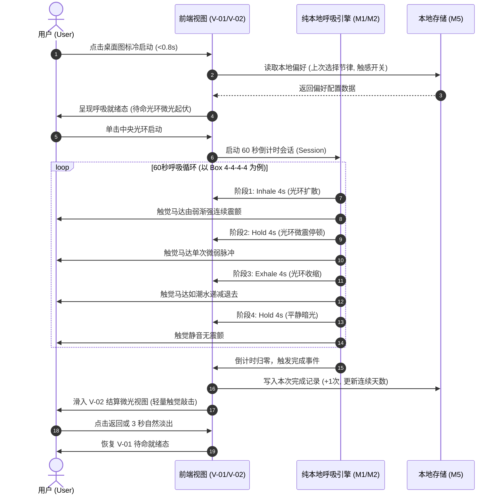
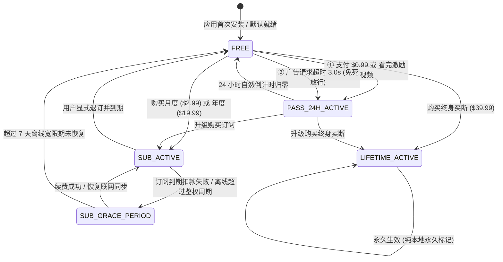

# StillMinute 静音一分钟 (SM01) 工序 05 交付物：产品需求规格说明书 (PRD)

```yaml
product_code: SM01
stage_id: "05"
stage_name: "产品需求定义"
iteration: "v1.0.0"
target_market: ["US", "JP"]
is_payment_related: true
is_privacy_related: false
is_user_data_related: true
is_encryption_related: false
is_modify_lead_permissions_related: false
is_public_statement_related: false
is_compliance_high_risk_related: false
is_budget_exceeded: false
data_dictionary_schema_change: true
```

## 负责人 30 秒拍板摘要卡 (Executive Gate)

- **3条核心量化结论**：
  1. **首发版本范围封版**：继承前序工序基线，SM01 v1.0.0 严格封版为 4 项 P0 核心能力（60秒极速触觉呼吸引擎、精细触觉节律引导、自适应深色光环动效、极简商业特权抽屉）及 2 项 P1 增强能力（4-7-8 舒缓扩展模式、触觉强度调节），彻底剔除长音频、开屏问卷与云端账号等伪需求。
  2. **端到端纯业务契约交付**：完整定义全站 5 大视图 (`V-01~V-05`)、6 大核心业务模块 (`M1~M6`) 五维规格卡、4 大业务实体数据字典、13 项全链路业务埋点 (`E-01~E-13`) 与 10 组 Gherkin 验收用例 (`AC-01~AC-10`)，杜绝任何代码与数据库技术越界。
  3. **商业与双端合规护栏固化**：无缝承接工序 02 四阶变现阶梯，固化“启动 3 秒零弹窗”与“广告 3.0s 超时免死放行”机制；严格锁定 iOS 灵动岛 (≥71pt) 与 Android 状态栏 (≥24dp) 安全区；严格落地 Apple App Tracking Transparency (ATT) 弹窗规格（含双语文案与用户拒绝后的降级分支）及 Google Play Advertising ID (AD_ID) 权限声明与家庭政策规范，合规审查全绿。
- **需负责人拍板的关键决策项**：
  - [ ] **默认首选呼吸节奏**：【推荐】出厂默认设定为经典方块呼吸法 (Box 4-4-4-4，兼顾美日两地平衡心智) vs 默认设定为 4-6 深度舒缓节律。
  - [ ] **练习完成结算自动关闭时效**：【推荐】60 秒练习结束后在结算视图展示 3 秒倒计时自动淡出返回待命态 vs 需用户显式手动点击任意位置退出。
- **下游传参锚点**：
  - 移交工序 06 (`ux`)：全站视图索引 `V-01~V-05` 布局与逐视图四态、双端安全区物理边距、44×44pt / 48×48dp 最小触控热区、Apple ATT 弹窗视觉层级与 Google Play 权限文案设计。
  - 移交工序 07 (`eng`)：业务实体字典（字段业务定义、枚举约束）、商业状态机转移条件、Apple ATT 与 Google Play AD_ID 权限声明与拒绝后降级分支逻辑、客户端零推理 (`client_zero_inference: true`) 纯本地架构诉求。
  - 移交工序 08 (`qa`)：Gherkin 验收矩阵 `AC-01~AC-10`（含 ATT 与 AD_ID 拒绝后看视频与练习 100% 零损耗降级）与首屏可见耗时 <0.8s 等感知级质量标准。

---

## 第 0 章：文档元信息与版本演进履历

### 0.1 文档基础元信息

| 元信息属性项 | 属性值与配置详情 | 说明与备注 |
| :--- | :--- | :--- |
| **单品代号 / 产品全称** | `SM01` / StillMinute 静音一分钟 | 出海轻量自律神经调节单品 |
| **当前交付工序** | `05` - 产品需求定义 (PRD) | 纯业务施工规格基线 |
| **迭代版本号** | `v1.0.0` (首发 MVP 封版) | 跨平台双端首发 (iOS & Android) |
| **主责角色** | 产品经理 Agent (`pm`) | 纯业务本位，无技术代码越界 |
| **目标发布市场** | US (美国), JP (日本) | 英语与深度在地化日语双语 |
| **系统架构红线约束** | 纯客户端零推理 (`client_zero_inference: true`) | 无云端计算消耗，纯本地离线优先 |
| **文档密级与权限** | 内部基线，受版本演进受控管理 | 仅限人类战略层与执行层 AI 调阅 |

### 0.2 版本演进与变更记录表

| 版本号 | 更新时间 | 变更类型 | 变更内容对照与核心业务摘要 | 受影响模块 | 审批人 |
| :---: | :---: | :---: | :--- | :--- | :---: |
| **v1.0.0** | 2026-10-29 | 初始建立 | • 承接前序工序基线，正式输出首版纯业务 PRD 规格基线。<br>• 固化全站 5 大视图拓扑 (`V-01~V-05`) 与 6 大核心业务卡 (`M1~M6`)。<br>• 继承工序 02 商业定价基线，映射四阶特权规则与离线鉴权策略。<br>• 制定纯业务实体字典、全链路埋点 (`E-01~E-12`) 与 Gherkin 验收 (`AC-01~AC-08`)。 | 全量模块 (M1~M6) | 负责人 |
| **v1.0.1** | 2026-10-29 | 合规修订 | • **响应合规风控 (cmp) 审查意见**：补充 Apple App Tracking Transparency (ATT) 弹窗规格说明。<br>• 明确 IDFA 采集仅用于跨应用广告归因，制定美日双语 (`en-US` / `ja-JP`) 原生系统弹窗文案。<br>• 明确用户拒绝追踪 (Denied) 后的优雅降级分支：归因降级为 SKAdNetwork 粗粒度归因，应用内核心功能（60秒呼吸、24h 通行证视频解锁、订阅购买）100% 零损耗正常使用，杜绝骚扰弹窗。<br>• 验收矩阵扩充 `AC-09` 覆盖 ATT 授权与拒绝降级体验。 | M6, 第四章, 第五章, 第七章 | 负责人 |
| **v1.0.2** | 2026-10-29 | 双端合规强化 | • **补充 Google Play Advertising ID (AD_ID) 权限声明与家庭政策规范**：<br>• 在第四章增加 4.8 节，正式声明 Android 端 Google Play 广告标识符 (`AD_ID`) 权限规范与使用目的。<br>• 明确声明符合 Google Play 家庭政策 (Families Policy)，设定应用目标年龄为 13 岁及以上成人，杜绝儿童违规投放；<br>• 完善 Android 用户停用个性化广告后的降级分支：系统接收全 0 标识符，激励视频与所有核心功能 100% 零损耗运转；<br>• 数据字典扩展 `ad_id_permission_status` 字段，埋点字典新增 `E-13`，验收矩阵扩展 `AC-10`。 | M6, 第四章, 第五章, 第六章, 第七章 | 负责人 |

### 0.3 需求变更单 (CR) 业务流转闭环机制
在后续工序推进中，任何下游角色（如工序 06 设计、工序 07 研发、工序 08 测试）提出的需求变更，必须遵循标准化 CR 闭环流程：
1. **CR 提出规范**：下游填写标准需求变更单（含 CR 编号、提出角色、变更原因、方案比对、影响工期与质量评估）。
2. **PM 业务评审**：由产品经理 Agent (`pm`) 评估是否符合精益减法原则与 UVP 定位。涉及破坏性改动的 CR 提交项目总控 (`lead`) 仲裁。
3. **版本履历更新**：CR 批准后，PM 必须在《第 0 章：版本演进履历》增量更新修订记录，平滑演进 PRD 基线版本（如 v1.0.2），严禁私自暴力篡改或清空前序基线。

---

## 第一章：版本定位与范围封版

### 1.1 业务背景与前序基线继承声明
本交付物全面继承前序已封版工序沉淀之事实基线，不作机械重复铺垫：
- **继承工序 01 市场研究基线**：聚焦出海高压人群在会议间隙、突发惊恐或公共通勤下的自律神经调节刚需；痛击竞品长达 15 分钟的臃肿课程与 $69.99 扣费陷阱。
- **继承工序 02 商业定价基线**：严格锚定全平台唯一价格阶梯——免费引流层（$0.00 / ¥0）、24h 通行证（$0.99 / ¥160 或 1 次视频）、月度轻订阅（$2.99 / ¥450）、年度主力订阅（$19.99 / ¥2,900）、终身买断（$39.99 / ¥5,800）；恪守“0 开屏广告/0 启动弹窗”与“广告 3.0s 超时免死放行”商业护栏。
- **继承工序 03 产品方向基线**：贯彻 UVP“口袋里的自律神经重置器：60秒静音触觉呼吸，零等待、零打扰、即开即吸”；坚守 10 秒触达 Aha Moment 极速旅程。
- **继承工序 04 市场验证基线**：承接低成本市场验证所达成的极简触觉交互逻辑，在首发 MVP 中全面转为正式业务施工规格。

### 1.2 北极星指标与核心业务量化目标

| 指标维度 | 核心业务监控指标 (KPI) | 目标设定值 | 业务定义与统计口径说明 |
| :--- | :--- | :---: | :--- |
| **核心北极星指标** | **每日 60 秒完整练习完播率** | **≥ 75.0%** | 当日启动呼吸引擎的用户中，完整维持 60 秒倒计时直至结算的用户占比。 |
| **极速激活指标** | **10 秒 Aha Moment 触达率** | **≥ 90.0%** | 冷启动至用户产生首次触觉吸气交互耗时 ≤10 秒的用户比例。 |
| **次日留存指标** | **次日活跃留存率 (D1 Retention)** | **≥ 40.0%** | 安装激活次日再次打开应用并完成至少一次 60 秒练习的用户占比。 |
| **商业变现指标** | **综合内购与通行证转化率** | **≥ 4.2%** | 累计活跃用户中选购 24h 通行证、订阅或买断的去重付费转化率。 |
| **感知性能指标** | **冷启动首屏就绪耗时** | **< 0.8s** | 点击桌面图标至呼吸圆环完全渲染且可接受触控的物理耗时。 |

### 1.3 精简用户故事 (User Stories)
- **US-01 (突发救急)**：作为一个高压办公族，我希望在会议间隙 0.8 秒内点开应用直接吸气，以便在 60 秒内迅速平复剧烈心跳，而不需要忍受任何问卷或开屏拦截。
- **US-02 (隐形放松)**：作为一个日本电车通勤族，我希望将手机放在西装口袋中跟随细腻震动完成深呼吸，以便在极其拥挤的公共场合隐蔽调节情绪，绝不发出任何声音。
- **US-03 (夜间入眠)**：作为一个失眠敏感者，我希望在全黑卧室中跟随柔和微光进行 4-7-8 呼吸，以便在零蓝光刺激的平静状态下自然入睡。
- **US-04 (无感变现)**：作为一个被流氓扣费伤害过的工具用户，我希望能够花费 $0.99 临时解锁 24 小时高级触觉，或者选购清晰透明的 $19.99 年订阅，获得充分的掌控感。
- **US-05 (双端隐私自主与家庭合规)**：作为一个注重隐私的数字用户，无论在 iOS (ATT) 还是 Android (AD_ID) 设备上，我希望能够完全掌控广告追踪权限；当我拒绝追踪或系统停用个性化广告时，应用全部功能依然 100% 正常可用，且严格符合双端隐私与家庭政策规范。

### 1.4 In-Scope (P0/P1) vs Out-of-Scope (Won't Have) 范围封版矩阵表

| 需求代号 | 功能模块名称 | 需求范围分级 | 纳入理由与业务价值交付 | 严苛边界与形态约束 |
| :---: | :--- | :---: | :--- | :--- |
| **M1** | 60 秒极速呼吸引擎 | **P0 (Must-Have)** | 承载核心 UVP，提供默认 60 秒一键深呼吸体验。 | 固定 60 秒倒计时，首版不提供自定义时长调节。 |
| **M2** | 精细多模触觉律动引导 | **P0 (Must-Have)** | 赋能口袋盲操与公共场景静音使用，差异化壁垒。 | 吸气渐强、呼气渐弱、屏息微震，纯本地驱动。 |
| **M3** | 自适应深色光环动效 | **P0 (Must-Have)** | 极简视觉钩子平移，提供自然呼吸流体缩放。 | 纯暗色 OLED 背景，无复杂 3D 渲染，轻量高帧。 |
| **M6** | 商业特权与通行证抽屉 | **P0 (Must-Have)** | 承接工序 02 变现阶梯，提供 24h 通行证与订阅入口。 | 半屏非打断抽屉，严禁启动时全屏强制拦截。 |
| **M4** | 4-7-8 深度舒缓扩展模式 | **P1 (Should-Have)** | 服务深度失眠与急性焦虑群体，增强产品留存厚度。 | 作为高阶权益提供，支持 24h 通行证或订阅解锁。 |
| **M5** | 练习历史与本地打卡徽记 | **P1 (Should-Have)** | 建立纯离线正向反馈，激励形成日常呼吸习惯。 | 仅展示过去 7 天打卡热力圆点，纯本地离线持久化。 |
| **N-01** | 长音频白噪音与名师课 | **Won't Have (砍除)** | 严重冗余，包体膨胀，违背即开即吸定位。 | 严禁引入任何音频解说、大体积背景音乐。 |
| **N-02** | 强制开屏测试与焦虑问卷 | **Won't Have (砍除)** | 严重增加救急心理阻力，导致用户瞬间流失。 | 严禁开屏出现任何多步骤问卷调查。 |
| **N-03** | 云端账户体系与社交分享 | **Won't Have (砍除)** | 增加服务器运维与隐私泄露风险，违背纯离线原则。 | 严禁设计手机号/第三方登录、好友排行榜。 |
| **N-04** | AI 情绪对话与大模型推理 | **Won't Have (砍除)** | 违背 `client_zero_inference: true` 铁律，增加算力成本。 | 严禁引入端侧或云端 LLM 推理模块。 |

---

## 第二章：全局信息架构与全站视图索引

### 2.1 全局信息架构路由拓扑图

```mermaid
flowchart TD
    AppLaunch["应用冷启动 / 调起 (<0.8s)"] --> V01["V-01 主呼吸就绪与运行视图<br>(默认就绪态 / 核心练习态)"]
    
    V01 -->|单击中央光环 / 向上滑动| V01_Active["V-01 运行中 (倒计时 60s 呼吸循环)"]
    V01_Active -->|中途轻触屏幕| V01_Pause["V-01 暂停态 (继续 / 退出)"]
    V01_Pause -->|确认退出| V01
    V01_Active -->|倒计时归零| V02["V-02 呼吸完成与成就结算视图<br>(微光徽记 / 3秒轻量停留)"]
    
    V02 -->|轻触任意区域 / 自动倒计时| V01
    V02 -->|点击升级高级体验| V04["V-04 商业化会员与通行证购买视图<br>(半屏抽屉 Bottom Sheet)"]
    
    V01 -->|点击右上角设置图标| V03["V-03 模式与触感设置抽屉视图<br>(呼吸法切换 / 触感调节)"]
    V03 -->|点击锁定高阶项目| V04
    V03 -->|点击关于与隐私| V05["V-05 关于与数据管理视图<br>(纯离线声明 / 重置本地数据)"]
    
    V01 -->|点击左上角会员标识| V04
    V04 -->|首次触发广告归因/看视频 (iOS)| ATT_Dialog["Apple 原生 ATT 授权弹窗<br>(仅首次触发 / 拒绝即降级)"]
    V04 -->|首次触发广告归因/看视频 (Android)| AD_ID_Check["Google Play AD_ID 权限与家庭合规<br>(无感识别 / 停用即降级)"]
    ATT_Dialog -->|允许 / 拒绝| V04
    AD_ID_Check -->|可用 / 停用个性化| V04
    V04 -->|完成购买 / 广告下发 / 关闭| V01
```

### 2.2 全站视图索引总表 (View Index Table: V-01 ~ V-05)

| 视图代号 | 视图名称 | 路由形态与展示容器 | 核心功能定位与内容承载 | 顶部安全区设计规范 | 底部安全区与热区规范 |
| :---: | :--- | :--- | :--- | :--- | :--- |
| **V-01** | **主呼吸就绪与运行视图** | 全屏常驻根视图 (Root View) | 呼吸光环核心动效、倒计时展示、吸气/呼气/屏息文字引导、轻量模式标签。 | iOS 避让灵动岛 (≥71pt)；Android 避让挖孔 (≥24dp)。 | 底部留白 ≥34pt，中央触控响应区 ≥280×280pt。 |
| **V-02** | **呼吸完成与成就结算视图** | 全屏模态轻量覆盖层 (Modal Overlay) | 60秒完成轻量鼓励徽记、连续打卡天数统计、升级高级触感轻量入口。 | 顶部安全区同 V-01，内容垂直居中呈现。 | 底部留出 40pt，点击屏幕任意区域秒级退出。 |
| **V-03** | **模式与触感设置抽屉视图** | 底部滑出半屏抽屉 (Bottom Sheet) | 呼吸模式选择 (Box / 4-7-8)、触感强度调节 (Soft / Crisp / Deep)、声音开关。 | 抽屉顶部设手柄拖动条，距屏幕顶部预留 ≥120pt。 | 列表单项行高 ≥56pt，开关触控热区 ≥48×48dp。 |
| **V-04** | **商业化会员与通行证购买视图** | 底部滑出 85% 高度抽屉 (Modal Sheet) | 四阶价格阶梯卡片展示、特权对比清单、看视频免密解锁通道、恢复购买入口、双端隐私合规承接。 | 抽屉内顶部设轻量关闭叉号，距安全区 ≥20pt。 | 底部固定购买 CTA 主按钮 (高度 52pt，热区充足)。 |
| **V-05** | **关于与数据管理视图** | 二级推入视图或独立模态页 (Sub-View) | 纯离线零云端隐私声明、非医疗免责声明、双端广告标识符合规说明、本地数据抹掉。 | 标配原生导航栏，返回按钮触控热区 ≥44×44pt。 | 底部留出 ≥34pt 避让系统指示条。 |

### 2.3 核心用户交互泳道图



---

## 第三章：功能模块详细规格说明

### 3.1 M1：60 秒即启呼吸引擎规格卡 (F-01)

#### ① 模块定位与核心意图导言
M1 是 StillMinute 的核心心脏。其核心意图是为遭遇急性焦虑、工作间歇或心率失衡的用户提供“零思考成本”的物理级生理重置。启动后 0 秒即入戏，通过精准的本地毫秒级时钟调度，驱动视觉与触觉节律，在整整 60 秒内带给用户深度平复体验。

#### ② 界面布局与组件清单表 (基于 V-01)

| 组件代号 | 组件名称 | 界面层级与视觉呈现 | 默认状态 | 约束与平台规范 |
| :---: | :--- | :--- | :--- | :--- |
| **C-101** | **核心动效呼吸光环** | 屏幕视觉正中央，外径 220pt~260pt | 待命呼吸浮动 (息速 0.2Hz) | 纯矢量绘制，暗色背景半透明磨砂光晕。 |
| **C-102** | **状态文字引导标签** | 位于光环中心偏上 30pt，字体 18pt Medium | 显示 "Tap to Start" 或 "Inhale" | 随吸气/呼气阶段平滑淡入淡出，无跳变感。 |
| **C-103** | **倒计时数字指示器** | 位于光环正中央，字体 40pt Light Monospace | 待命显示 "01:00"，运行时逐秒递减 | 采用等宽数字字体，杜绝跳动抖动。 |
| **C-104** | **极简模式微标签** | 位于光环正下方 48pt，胶囊状半透明药丸 | 显示当前模式如 "Box 4-4-4-4" | 字体 13pt，点击可直接呼出 V-03 模式抽屉。 |
| **C-105** | **顶部轻量导航工具栏** | 屏幕顶部安全区下方，包含会员与设置图标 | 左右两侧分别对齐 | 按钮图标尺寸 24×24pt，点击热区 ≥44×44pt。 |

#### ③ 交互流转与计算规则表

| 交互动作 / 触发事件 | 响应机制与状态机扭转 | 业务计算与节律规则 | 异常与防抖约束 |
| :--- | :--- | :--- | :--- |
| **点击中央光环 / 向上滑动手势** | 从【待命态 Ready】切换至【运行态 Running】。倒计时从 60 秒开始递减。 | 以当前选定模式节律（如 Box 4s-4s-4s-4s）启动第一轮吸气循环，同步调起 M2 触觉。 | 300ms 防重复点击拦截，运行期间忽略单击。 |
| **运行中单击屏幕任意空白区域** | 从【运行态 Running】切换至【暂停态 Paused】。光环停止缩放，显示暂停浮层。 | 倒计时与触觉驱动即时冻结，记录已完成秒数。 | 浮层提供“继续”与“放弃退出”双选项。 |
| **倒计时达到 00:00 (完成)** | 呼吸引擎停止，触发完成音效/触觉，转入 V-02 结算视图。 | 本地练习总次数 +1，若当日首次完成则连续打卡天数 +1。 | 运行满 60 秒视为有效完播，不足 60 秒放弃不计入完播。 |

#### ④ 边界条件与异常降级表

| 边界场景与异常状况 | 降级处理机制与用户端表现 | 体验保障策略 |
| :--- | :--- | :--- |
| **应用在前台运行中被推入后台** | 呼吸引擎自动置为暂停态，停止马达震动与动效刷新。 | 防止在后台无意义消耗电池电量与误震颤；用户切回前台后保留暂停状态供继续。 |
| **练习中途接入系统电话或闹钟** | 系统中断回调时自动保存断点并静音暂停。 | 恢复通话后显示友好暂停提示，用户可自主决定继续完成或重置。 |

#### ⑤ 模块验收点索引
- 关联验收用例：`AC-01` (60秒极速呼吸全流程流转与完播结算)。

---

### 3.2 M2：精细多模触觉律动引导规格卡 (F-02)

#### ① 模块定位与核心意图导言
M2 是实现“口袋盲操”与“全静音生理引导”的关键支撑。针对日本与欧美通勤、开会等不能看屏幕、不能外发声音的场景，通过调用设备底层线性马达，以纯粹的触感波纹让用户闭上双眼也能精准感知吸气与呼气节律。

#### ② 界面布局与组件清单表 (基于 V-03 抽屉)

| 组件代号 | 组件名称 | 界面层级与视觉呈现 | 默认状态 | 约束与平台规范 |
| :---: | :--- | :--- | :--- | :--- |
| **C-201** | **触觉反馈总开关** | V-03 列表首项，原生 Switch 开关 | 默认开启 (ON) | 关闭后停止一切马达震动，仅保留视觉光环。 |
| **C-202** | **触觉强度分段选择器** | V-03 触感设置区，三段式 Segmented Control | 默认选中 "Crisp (标准清晰)" | 提供 Soft (柔和)、Crisp (清脆)、Deep (沉浸深度)。 |
| **C-203** | **触感试触微交互** | 切换不同强度选项卡时的即时触感触发 | 切换瞬间触发一次对应触觉 | 限制单次脉冲时长 ≤80ms，避免持续震动不适。 |

#### ③ 交互流转与计算规则表

| 呼吸阶段 | 触觉模式规则 (iOS Taptic Engine / Android Haptic) | 振动强度算法规则 | 业务意图与心理映射 |
| :--- | :--- | :--- | :--- |
| **吸气阶段 (Inhale)** | 连续高频细密脉冲波纹 (Continuous Gradient Haptic) | 振动强度从 10% 线性匀速递增至 90%，步长 20ms。 | 模拟气体充盈胸腔的物理实在感。 |
| **屏息阶段 (Hold)** | 阶段起始单次轻量微震 (Light Transient Tap) | 单次 20ms 微弱击打，随后保持绝对静止。 | 提示用户进入停顿屏息，不打扰内省宁静。 |
| **呼气阶段 (Exhale)** | 递减平滑脉冲波纹 (Decaying Wave Haptic) | 振动强度从 80% 平滑衰减至 0%，模拟潮汐退却。 | 引导神经系统副交感神经兴奋，深度释放压力。 |
| **结束阶段 (Complete)**| 连续双重清脆敲击 (Success Double Tap) | 两次间隔 120ms 的 Success 级别触感反馈。 | 明确告知 60 秒目标达成，给予心理成就确认。 |

#### ④ 边界条件与异常降级表

| 边界场景与异常状况 | 降级处理机制与用户端表现 | 体验保障策略 |
| :--- | :--- | :--- |
| **低端 Android 机型缺乏线性微马达** | 系统自动降级为原生轻触震动模式。 | 杜绝产生刺耳机械马达轰鸣，若仍不可控则在设置内引导关闭震动。 |
| **系统处于“低电量模式 (Low Power)”** | 触觉算法自动降低刷新频次（由 50Hz 降至 20Hz 脉冲）。 | 保护系统电量，避免触发系统强制关闭马达保护。 |

#### ⑤ 模块验收点索引
- 关联验收用例：`AC-02` (精细触觉节律与静音口袋盲操)。

---

### 3.3 M3：自适应深色呼吸光环动效规格卡 (F-03)

#### ① 模块定位与核心意图导言
M3 将工序 01 提炼的“3秒流体光环 (Orb)”视觉钩子无缝还原至产品主视觉。动效采用纯纯粹深色暗调设计，旨在为突发焦虑或深夜失眠用户阻断蓝光刺激，通过极具呼吸感的缩放光晕，诱发视神经聚焦，引导自律神经自然复位。

#### ② 界面布局与组件清单表 (基于 V-01)

| 组件代号 | 组件名称 | 界面层级与视觉呈现 | 默认状态 | 约束与平台规范 |
| :---: | :--- | :--- | :--- | :--- |
| **C-301** | **主流动着色器光球** | V-01 居中核心，外径基础尺寸 160pt | 待命状态以 0.2Hz 轻微呼吸浮动 | 严格执行轻量矢流动效，严禁引入高能耗 3D 引擎。 |
| **C-302** | **同心扩散光晕环** | 环绕光球外部的 2 层半透明柔光圆环 | 随吸气向外扩散半径达 260pt | 透明度在 0.15~0.4 之间平滑过渡，柔和不刺眼。 |
| **C-303** | **纯黑防蓝光底色** | 整个应用视图背景，十六进制 `#000000` / `#0A0A0C` | 纯黑常驻暗色调 | 适配 OLED 屏幕全黑像素熄灭，节能且保护夜间瞳孔。 |

#### ③ 交互流转与计算规则表

| 状态与阶段 | 动效数学变换规则 | 视觉缩放曲线 (Curve) | 视觉引导目标 |
| :--- | :--- | :--- | :--- |
| **待命呼吸态 (Idle)** | 缩放比例在 0.95 至 1.05 之间循环缓慢波动。 | EaseInOutSine, 周期 5.0 秒。 | 传递静候呼吸的生命感与宁静感。 |
| **吸气阶段 (Inhale)** | 光球尺寸由 1.0 匀速膨胀至 1.55，光晕扩散范围扩大。 | CubicBezier(0.4, 0.0, 0.2, 1.0)，历时 4.0 秒。 | 诱导视觉注意力随膨胀扩张深吸入气。 |
| **屏息阶段 (Hold)** | 保持在 1.55 最大尺寸，边缘呈现高频微幅微光涟漪。 | 保持静止，微光透明度小幅震颤。 | 稳定心智，维持充盈掌控感。 |
| **呼气阶段 (Exhale)** | 光球尺寸由 1.55 缓慢回缩至 1.0，光晕渐隐内聚。 | CubicBezier(0.25, 0.1, 0.25, 1.0)，历时 4.0 秒。 | 引导视线收拢，伴随呼气完全放松肩颈。 |

#### ④ 边界条件与异常降级表

| 边界场景与异常状况 | 降级处理机制与用户端表现 | 体验保障策略 |
| :--- | :--- | :--- |
| **系统开启“减少动态效果 (Reduce Motion)”** | 动效自动关闭空间位移与剧烈缩放，仅保留平滑透明度明暗呼吸。 | 遵守可访问性 (a11y) 国际标准，避免前庭眩晕敏感用户不适。 |
| **设备过热或系统掉帧严重** | 动态降低动画粒子采样率，锁定基础 60fps 插值。 | 保证核心 60 秒倒计时精确无误，不卡顿、不发烫。 |

#### ⑤ 模块验收点索引
- 关联验收用例：`AC-03` (自适应深色呼吸光环动效与 Reduce Motion 降级)。

---

### 3.4 M4：4-7-8 深度舒缓扩展模式规格卡 (F-05)

#### ① 模块定位与核心意图导言
M4 是针对特定失眠敏感族与惊恐高发族设计的专项高阶呼吸算法。基于哈佛与斯坦福生理学研究，通过 4 秒吸气、7 秒深度屏息与 8 秒极致长呼气，强化副交感神经张力。该功能作为商业化特权项，供免费试用、24h 通行证或订阅用户解锁使用。

#### ② 界面布局与组件清单表 (基于 V-03)

| 组件代号 | 组件名称 | 界面层级与视觉呈现 | 默认状态 | 约束与平台规范 |
| :---: | :--- | :--- | :--- | :--- |
| **C-401** | **呼吸模式列表项 (Box)** | V-03 模式选择区首项，标明 "Box 4-4-4-4 (日常平衡)" | 默认勾选 (免费全员开放) | 基础免费模式，永久可用。 |
| **C-402** | **呼吸模式列表项 (4-7-8)**| V-03 模式选择区第二项，标明 "4-7-8 (深度助眠/解惊恐)" | 未解锁时尾部带小锁徽记 🔒 | 付费特权项，点击未解锁项弹出 V-04 购买抽屉。 |
| **C-403** | **模式节律解析说明卡** | 选中具体模式后在抽屉下方展开的 2 行人话说明 | 显示节律生理功效与科学原理 | 严禁出现“治疗抑郁、治疗高血压”等医疗违规宣称。 |

#### ③ 交互流转与计算规则表

| 模式代号 | 节律参数循环规则 | 单轮耗时 | 60秒内循环执行逻辑 |
| :--- | :--- | :---: | :--- |
| **Box 4-4-4-4** | 吸气 4s -> 屏息 4s -> 呼气 4s -> 屏息 4s | 16 秒 / 轮 | 完整执行 3 轮 (48s)，末尾执行第 4 轮吸气呼气至 60 秒整优雅收尾。 |
| **4-7-8 Sleep** | 吸气 4s -> 屏息 7s -> 呼气 8s | 19 秒 / 轮 | 完整执行 3 轮 (57s)，末尾 3 秒平缓过渡至结算完成态。 |

#### ④ 边界条件与异常降级表

| 边界场景与异常状况 | 降级处理机制与用户端表现 | 体验保障策略 |
| :--- | :--- | :--- |
| **24h 通行证到期时正在使用 4-7-8 模式** | 当前正在进行的 60 秒练习允许完整跑完，绝不中途掐断。 | 本次练习完成后，下次练习自动回退至免费的 Box 模式，并弹友好提示。 |

#### ⑤ 模块验收点索引
- 关联验收用例：`AC-04` (4-7-8 模式权限鉴权与节律流转)。

---

### 3.5 M5：练习历史与本地打卡徽记规格卡 (F-08)

#### ① 模块定位与核心意图导言
M5 旨在为用户提供轻量级成就满足感与日常习惯固化。坚决砍掉社交排行榜与繁重数据图表，仅以“过去 7 天极简热力圆点”和“累计深呼吸分钟数”，让用户在纯本地、完全离线的情境下直观看到自我情绪掌控的沉淀。

#### ② 界面布局与组件清单表 (基于 V-02 / V-05)

| 组件代号 | 组件名称 | 界面层级与视觉呈现 | 默认状态 | 约束与平台规范 |
| :---: | :--- | :--- | :--- | :--- |
| **C-501** | **7 天打卡热力圆点** | V-02 结算视图中央及 V-05 顶部，7个水平小圆点 | 当日未完成为空心灰点，完成后为发光微球 | 仅记录最近 7 天，过往数据自动汇总为月度统计。 |
| **C-502** | **累计呼吸成就指示** | 位于热力圆点下方，显示如 "3 Sessions • 3 Mins Total" | 动态展示本地聚合数值 | 纯本地计算，不依赖任何云端数据。 |
| **C-503** | **健康数据同步切换开关** | V-05 列表项，"Sync to Apple Health / Health Connect" | 默认关闭 (OFF) | 仅在用户主动授权后，写入“正念分钟数 (Mindful Minutes)”。 |

#### ③ 交互流转与计算规则表

| 触发事件 | 本地业务存储计算规则 | 数据归档与统计规则 | 隐私与合规保护 |
| :--- | :--- | :--- | :--- |
| **完成一次 60 秒练习** | 本地当天完成计数 +1，累计分钟数 +1。更新最后练习时间戳。 | 若当天为连续完成（距离上次练习 ≤36 小时且跨自然日），Streak +1。 | 纯本地记录，绝不收集设备 ID 或网络 IP 上传云端。 |
| **用户点击“抹掉所有数据”** | 弹出二次确认弹窗，确认后清空所有本地练习历史表并重置打卡状态。 | 本地偏好恢复出厂初始态，计数器全部归零。 | 满足 GDPR / CCPA 被遗忘权与数据自主掌控要求。 |

#### ④ 边界条件与异常降级表

| 边界场景与异常状况 | 降级处理机制与用户端表现 | 体验保障策略 |
| :--- | :--- | :--- |
| **跨时区国际旅行导致系统时间跳变** | 记录以本地自然日判定打卡，若时间戳发生小幅回退，不清除原有连续打卡天数。 | 采取宽容打卡判定，避免因时差让用户产生挫败感。 |

#### ⑤ 模块验收点索引
- 关联验收用例：`AC-05` (纯本地打卡徽记生成与数据抹掉业务规则)。

---

### 3.6 M6：极简商业化通行证与订阅抽屉规格卡 (F-04)

#### ① 模块定位与核心意图导言
M6 承接工序 02 商业定价基线，是实现“高转化、零恶评”变现闭环的业务载体。坚守“启动 3 秒零弹窗”与“无全屏拦截”底线，以优雅半屏抽屉形式呈现免费层、24h 通行证、轻量订阅与买断选项，并内建超时免死放行机制与双端合规归因体系，确保用户在焦虑平复过程中不受商业干扰。

#### ② 界面布局与组件清单表 (基于 V-04 抽屉)

| 组件代号 | 组件名称 | 界面层级与视觉呈现 | 默认状态 | 约束与平台规范 |
| :---: | :--- | :--- | :--- | :--- |
| **C-601** | **抽屉顶栏与关闭入口** | 抽屉顶部，居中圆角拖动手柄，右侧轻量关闭叉号 | 始终可见 | 支持向下滑动手势快速关闭，触控热区 ≥44×44pt。 |
| **C-602** | **四阶定价卡片组合** | 纵向或水平轮播卡片，清晰标注官方定价与折算说明 | 默认高亮推荐 "Annual Pro ($19.99/年)" | 价格必须严格呈现 $0.00 / $0.99 / $2.99 / $19.99 / $39.99。 |
| **C-603** | **看视频免费解锁 24h 通行证入口**| 位于 $0.99 通行证卡片内，"Watch 1 Ad to Unlock" | 当激励视频已就绪或未超频时可用 | 每日频控最多 3 次，醒目注明 24 小时生效倒计时。 |
| **C-604** | **试用提醒承诺说明文案** | 位于年度订阅卡片下方，12pt 浅灰文字 | 始终展示透明试用规则 | 明确承诺“试用期结束前 48 小时主动通知提醒，绝无流氓扣费”。 |
| **C-605** | **恢复购买与条款入口** | 抽屉底部居中极细字排布，"Restore Purchases • Terms • Privacy" | 始终可点击 | 满足苹果 App Store 与 Google Play 提审强制要求。 |

#### ③ 交互流转与计算规则表

| 用户交互动作 | 业务处理流程与状态扭转 | 计费与权益下发逻辑 | 异常处理机制 |
| :--- | :--- | :--- | :--- |
| **点击“Watch 1 Ad”观看激励视频** | 调起激励视频播放。播放完整结束后，关闭抽屉并下发权益。 | 本地权益状态写入 `PASS_24H`，记录生效起始与过期时间戳 (+24 Hours)。 | 若广告 SDK 请求超过 3.0s 超时或网络异常，触发 G-02 免死放行直接下发权益。 |
| **点击内购选项卡并完成支付** | 调起原生系统支付确认。支付成功后，立即刷新权益状态。 | 根据购买 SKU 更新状态为 `SUB_ACTIVE` 或 `LIFETIME`，解除所有高阶功能锁。 | 若用户取消支付，抽屉保持打开，不报错、不弹骚扰挽留窗。 |
| **点击“Restore Purchases”** | 调起本地收据与原生商店鉴权刷新。 | 若检测到有效订阅或买断记录，恢复对应特权并弹出成功提示。 | 若未查询到有效购买记录，友好提示“未发现有效购买记录”。 |

#### ④ 边界条件与异常降级表

| 边界场景与异常状况 | 降级处理机制与用户端表现 | 体验保障策略 |
| :--- | :--- | :--- |
| **用户在完全离线无网环境下打开应用** | 系统自动读取本地 7 天离线特权信任缓存。 | 缓存期内保持特权开放，绝不降级为免费版；超过 7 天无网才降为免费版。 |
| **网络极差导致内购拉取商品列表失败** | 抽屉展示本地内置默认兜底价格卡片，允许重试。 | 确保用户仍可阅读特权说明，不出现大面积白屏或崩溃。 |

#### ⑤ 模块验收点索引
- 关联验收用例：`AC-06` (商业化特权购买、恢复与广告超时免死放行)。

---

## 第四章：商业化计费与权限业务规则

### 4.1 商业化权益状态机 (Entitlement State Machine)



### 4.2 SKU 定价阶梯映射表 (全平台统一价格基线)

> **价格唯一性声明**：本业务规格书中所有价格严格继承工序 02 商业分析已封版基线，任何角色不得擅自改动。

| SKU 代号 | 商业档位名称 | US 官方定价 | JP 官方定价 | 计费周期 / 机制 | 包含的核心业务权益 |
| :---: | :--- | :---: | :---: | :--- | :--- |
| `SM_FREE` | **免费引流层** | **$0.00** | **¥0** | 永久免费 | 60 秒极简呼吸引擎、Box 4-4-4-4 呼吸法、基础触觉引导、本地 7 天打卡。 |
| `SM_PASS_24H` | **24h 通行证** | **$0.99**<br>*(或看1次视频)* | **¥160**<br>*(或看1次视频)* | 单次购买，生效 24 小时 | 24 小时全功能畅享：解锁 4-7-8 助眠模式、高阶触感调节、微光夜间主题。 |
| `SM_SUB_MONTHLY` | **月度轻订阅** | **$2.99 / 月** | **¥450 / 月** | 按月自动续费 | 包含通行证所有特权、优先体验后续新节律、健康数据自动同步。 |
| `SM_SUB_ANNUAL` | **年度主力订阅** | **$19.99 / 年**<br>*(合 $1.67/月)* | **¥2,900 / 年**<br>*(合 ¥242/月)* | 按年自动续费 (含 7 天试用) | 包含月度所有特权、试用期提前 48 小时提醒、桌面小组件快捷调起支持。 |
| `SM_LIFETIME` | **终身买断** | **$39.99** | **¥5,800** | 单次终身买断 | 永久解锁所有特权与未来更新、专属创世微光徽记、彻底免除后续续费。 |

### 4.3 免费 vs 付费特权权益对照矩阵

| 业务功能特权项 | 免费引流层 (`SM_FREE`) | 24h 通行证 (`SM_PASS_24H`) | 付费订阅 / 终身买断 (`SM_PRO`) | 商业意图与设计考量 |
| :--- | :---: | :---: | :---: | :--- |
| **60秒极速触觉呼吸 (Box)** | ✅ 完全开放 (核心体验) | ✅ 完全开放 | ✅ 完全开放 | 保证核心 UVP 零门槛触达，守护 4.8+ 口碑。 |
| **4-7-8 深度舒缓/助眠模式** | 🔒 锁定 (展示小锁) | ✅ 24小时解锁可用 | ✅ 永久无限次可用 | 高阶需求促转，吸引夜间失眠与急性焦虑客群。 |
| **触感强度三档调节 (Soft/Crisp/Deep)** | 仅限 Crisp 标准档 | ✅ 24小时解锁全档位 | ✅ 永久自由调节 | 满足触感挑剔人群与高品质手机用户体验。 |
| **Apple Health / Google Fit 自动同步** | 仅支持手动导出 | ✅ 24小时支持同步 | ✅ 自动后台静默同步 | 锁定高净值自律健康管理客群。 |
| **启动速度与纯净无弹窗保证** | ✅ 100% 保证启动 0 弹窗 | ✅ 100% 保证启动 0 弹窗 | ✅ 100% 保证启动 0 弹窗 | 绝对红线：任何档位均坚决不设开屏广告。 |

### 4.4 付费门槛触发时机与业务交互规则
1. **轻量触发原则**：严禁在用户正在进行 60 秒呼吸过程中弹出任何付费提示；严禁在启动应用 3 秒内展示弹窗。
2. **自然触发节点**：
   - **节点 A (主动探索)**：用户在 V-03 抽屉中点击带有 🔒 徽记的高阶项目（如 4-7-8 模式或触感深度档位）时，平滑展开 V-04 购买抽屉；
   - **节点 B (完成激励)**：用户完整完成一次 60 秒呼吸并停留在 V-02 结算页时，在屏幕底部展示轻量卡片“体验 4-7-8 助眠模式，探索更多深度触感”，点击滑出 V-04；
   - **节点 C (常驻入口)**：V-01 顶部工具栏常驻轻量会员微图标，用户可随时主动点击调阅。

### 4.5 异常降级与体验容灾规则
1. **G-02 广告超时免死放行机制**：
   - 当用户在 V-04 选择“看视频解锁 24h 通行证”时，应用向广告网络发起拉取请求；
   - 若系统计时器达到 **3.0 秒** 广告仍未就绪（如弱网、广告源无填充、超时报错），系统**无条件直接判定激励达成**，立即关闭抽屉并下发 24h 通行证，展示轻量提示：“网络连接稍慢，已为您直接开通 24 小时通行体验”；
   - 坚决保障用户在寻求情绪救急时不被商业 SDK 卡死。
2. **G-04 离线 7 天信任缓存机制**：
   - 设备在离线断网环境下，系统完全信任本地存储的最后有效鉴权令牌，有效期设定为 **7 天 (168 小时)**；
   - 7 天内断网使用，高阶特权绝不降级，确保在飞机、地下室或偏远无网状态下正常享受高级模式。

### 4.6 防刷与风控业务规则
- **单设备每日激励视频频控**：单台设备自然日内通过激励视频获取通行证上限为 **3 次**。超过 3 次后，按钮置灰并提示“今日练习频次已非常健康，建议稍事休息”。
- **系统时间篡改防范**：本地记录上次运行时间戳。若检测到当前系统时间早于上次运行时间达 2 小时以上（判定为恶意回拨系统时间以延长 24h 通行证），系统自动将通行证重置为到期状态，回退至免费层。

### 4.7 Apple App Tracking Transparency (ATT) 弹窗规格与用户拒绝后的降级分支

依据合规风控 (cmp) 审查红线与 Apple App Store Review Guidelines 5.1.2 规定，如需采集 IDFA 进行跨应用广告归因（如评估 TikTok / Search Ads 投放 ROI 与反作弊），PRD 必须包含 ATT 授权弹窗文案与用户拒绝后的降级分支：

#### 4.7.1 采集目的与 ATT 授权触发时机
- **明确采集目的**：仅在 iOS 平台采集 IDFA (Advertising Identifier) 用于衡量跨应用获客广告投放效果，绝不收集用户姓名、手机号、呼吸节律等任何个人健康敏感数据。
- **绝不开屏强行索权**：严禁在应用冷启动首屏（V-01 初始加载）立即弹出 ATT 弹窗。冷启动弹窗会严重破坏 0.8s 极速入戏心智，且触发极高拒绝率与商店审核质疑。
- **最佳触发节点**：
  - 用户在 V-04 商业特权抽屉中首次点击“Watch 1 Ad to Unlock 24h Pass (看视频解锁通行证)”准备拉取广告网络之前；
  - 或用户在完成首次 60 秒练习并在 V-02 点击“解锁高级触感”进入商业化场景时。
- **业务原则**：必须让用户首先体验到核心 60 秒呼吸带来的平静价值，再触发系统原生 ATT 授权流程。

#### 4.7.2 ATT 授权弹窗文案规格 (`NSUserTrackingUsageDescription`)

在 iOS 系统应用配置中，必须精确配置美日双语的原生解释文案，人话阐明采集目的，并承诺健康隐私数据绝不上云：

| 目标区域 | 语言代码 | ATT 授权弹窗文案 (`NSUserTrackingUsageDescription`) | 业务意图与信任传递 |
| :--- | :---: | :--- | :--- |
| **US (美国英语区)** | `en-US` | *"We use this identifier solely to measure the effectiveness of our advertising campaigns and deliver relevant offers. Your breathing sessions, haptic preferences, and mental wellness data remain 100% private and strictly offline on your device."* | 明确采集仅限广告衡量，重申呼吸与健康数据 100% 纯本地离线。 |
| **JP (日本日语区)** | `ja-JP` | *"この識別子は、広告効果の測定および適切なご案内の提供にのみ使用されます。お客様の呼吸練習の記録や触覚設定などのプライバシー情報は一切外部に送信されず、端末内で安全に完結します。"* | 消除日本用户对隐私泄露的担忧，强调“端末内完結（设备内闭环）”。 |

#### 4.7.3 用户决策处理矩阵与用户拒绝后的降级分支 (Graceful Degradation)

系统根据用户在原生 ATT 弹窗上的决策，执行确定性业务分支流转：

| 用户选择分支 | 系统底层授权状态 | 跨应用广告归因处理逻辑 | 用户端功能与体验表现 (降级分支规则) |
| :--- | :--- | :--- | :--- |
| **分支 1：用户允许<br>(Allow Tracking)** | `ATTrackingManager.AuthorizationStatus.authorized` | 允许归因 SDK 读取真实 IDFA，用于精准衡量买量渠道点击与转化效果。 | 正常进入后续业务流程，无感知变化。 |
| **分支 2：用户拒绝后的降级分支<br>(Ask App not to Track)** | `ATTrackingManager.AuthorizationStatus.denied` 或 `restricted` | **归因层优雅降级**：<br>① 系统返回全 0 字符串 (`00000000-0000-0000-0000-000000000000`)；<br>② 绝对禁止任何自制跨应用指纹追踪或设备硬编码采集；<br>③ 归因逻辑自动降级为 Apple 原生 SKAdNetwork 粗粒度聚合归因模式。 | **【核心降级保证：100% 体验与功能零损耗】**：<br>① **核心呼吸零影响**：用户照常使用 60 秒极速呼吸引擎、Box 模式与触觉震动；<br>② **商业特权零歧视**：看视频解锁 24h 通行证照常下发，所有内购订阅与买断通道畅通无阻，绝不降低视频画质，绝不要求二次看广告；<br>③ **本地打卡零受限**：打卡热力圆点、分钟数统计完全正常；<br>④ **零骚扰原则**：应用内严禁弹出任何自定义弹窗强行要求用户前往“系统设置-隐私”重新开启，严格尊重用户意愿。 |

---

### 4.8 Google Play Advertising ID (AD_ID) 权限声明与家庭政策规范

依据合规风控 (cmp) 审查红线与 Google Play Developer Policy（尤其是 Play Console 广告标识符使用政策与目标受众和内容/家庭政策），如需使用 Google Play 广告标识符，PRD 必须声明 AD_ID 权限并符合家庭政策规范：

#### 4.8.1 AD_ID 权限声明与业务使用目的
- **AD_ID 权限声明**：在 Android 平台中，应用需使用 Google Play 广告标识符 (`Advertising ID` / `AD_ID`) 开展跨渠道广告安装归因与反作弊分析。针对面向 Android 13 (API 级别 33) 及更高版本的发布，PRD 正式声明引入 `com.google.android.gms.permission.AD_ID` 权限。
- **使用目的边界**：
  1. 仅用于买量安装归因与转化漏斗分析（通过 Google Play Install Referrer 与受认可合规归因 SDK）；
  2. 严禁将 AD_ID 与任何个人身份信息 (PII) 或本应用内的离线正念健康数据进行任何形式的关联；
  3. 严禁将 AD_ID 传输给未经验证的第三方未经许可数据中介。

#### 4.8.2 符合 Google Play 家庭政策规范 (Families Policy Compliance)
为确保在 Google Play 商店顺利过审并杜绝合规风险，本产品明确遵守家庭政策规范：
1. **明确目标受众年龄范围**：
   - 本应用定位为成年职场与高压人群的轻量情绪呼吸调节工具，在 Google Play Console 目标受众与内容问卷 (Target Audience and Content) 中，**明确声明目标受众年龄为「13 岁及以上 (13+) / 成人 (18+)」**；
   - **本应用不以儿童为主要目标受众 (Not primarily directed to children)**，应用商店元数据与宣传物料中严禁出现低幼卡通、儿童向暗示或诱导儿童使用之表述。
2. **SDK 与广告合规要求**：
   - 集成的激励视频广告网络 SDK 必须符合 Google Play 政策要求；若未来涉及可能包含儿童的混合年龄受众，必须自动开启儿童隐私保护标志（如 Google Mobile Ads `tagForChildDirectedTreatment` 或 `tagForUnderAgeOfConsent`），禁用基于兴趣的个性化重定向广告；
   - 严格杜绝展示任何不适宜未成年人的暴力、赌博或成人广告内容。

#### 4.8.3 用户拒绝与停用个性化广告后的降级分支 (AD_ID Opt-Out Fallback)
在 Android 系统中，用户可在系统设置中随时开启“停用个性化广告 (Opt out of Ads Personalization)”或直接重置/删除广告 ID。系统必须提供完善的降级分支：

| Android 用户状态 / 行为 | 系统底层 AD_ID 状态 | 归因处理逻辑 | 用户端功能与体验表现 (降级分支规则) |
| :--- | :--- | :--- | :--- |
| **正常启用广告标识符** | 返回标准 36 位 UUID 格式的真实 Advertising ID。 | 归因 SDK 正常记录安装归因渠道与买量转化 ROI。 | 正常体验所有功能与激励视频。 |
| **用户停用个性化广告或删除广告 ID<br>(用户拒绝/停用降级分支)** | Google Play 服务底层自动返回全 0 字符串 (`00000000-0000-0000-0000-000000000000`)。 | 归因逻辑自动降级为非个性化安装来源粗粒度归因 (Google Play Install Referrer 纯渠道标记)；严禁采用设备指纹或硬件序列号强行追踪。 | **【核心降级保证：100% 体验与功能零损耗】**：<br>① **核心体验零影响**：用户 60 秒极速呼吸、触感节律完全不受限；<br>② **商业激励视频零阻碍**：用户点击“看视频解锁 24h 通行证”依然能够正常拉取并播放合规的非个性化广告，观看完成后 100% 正常下发 24h 通行证；<br>③ **内购与买断通道畅通**：Google Play Billing 购买与订阅恢复完全正常；<br>④ **零弹窗骚扰**：绝不弹出提示框诱导用户去系统设置重新启用个性化广告。 |

---

## 第五章：核心业务数据字典与本地存储业务策略

> **PM 纯业务本位申明**：本章节纯粹从产品经理业务视角定义数据实体、字段含义、枚举约束与隐私策略。严禁包含任何工程技术实现代码、SQL 建表 DDL (`CREATE TABLE`)、数据库索引或代码级 JSON Schema！所有数据库物理表结构与存储选型由工序 07 研发实现全权负责。

### 5.1 核心业务实体清单与业务关系说明
本应用为纯客户端离线架构，核心数据全部承载于设备端，包含四大业务实体：
1. **用户偏好设置实体 (`UserPreference`)**：记录用户的全局开关、触感强度选择、默认呼吸节律、健康同步授权、Apple ATT 授权状态与 Google Play AD_ID 授权状态。
2. **呼吸练习记录实体 (`BreathingSession`)**：记录每一次呼吸练习的时长、所选模式、是否完整完成以及完成时间戳。
3. **商业会员权益实体 (`EntitlementState`)**：记录当前设备的商业权益状态、通行证到期时间、订阅到期时间及离线缓存时间戳。
4. **每日成就统计实体 (`DailyAchievement`)**：按自然日聚合记录练习总次数、累计总分钟数与连续打卡天数。

```
[UserPreference (用户偏好)] ── (1:N) ──> [BreathingSession (练习记录)]
                                                │ (按天聚合)
                                                ▼
[EntitlementState (商业权益)]          [DailyAchievement (每日成就)]
```

### 5.2 逐实体业务数据字典表

#### 5.2.1 用户偏好实体业务字典 (`UserPreference`)

| 业务字段名 | 业务含义说明 | 业务数据类型 | 是否必填 | 取值范围 / 枚举值列表 | 默认值 | 校验失败提示文案 |
| :--- | :--- | :--- | :---: | :--- | :---: | :--- |
| `selected_mode` | 当前选中的呼吸模式 | 文本枚举值 | 是 | `BOX_4_4_4_4`, `SLEEP_4_7_8` | `BOX_4_4_4_4` | "请选择有效的呼吸模式" |
| `haptic_enabled` | 触觉振动总开关 | 布尔值 | 是 | `true` (开启), `false` (关闭) | `true` | "触觉开关状态非法" |
| `haptic_intensity`| 触觉反馈强度档位 | 文本枚举值 | 是 | `SOFT`, `CRISP`, `DEEP` | `CRISP` | "请选择有效的触觉强度" |
| `sound_enabled` | 辅助提示音总开关 | 布尔值 | 是 | `true` (开启), `false` (关闭) | `false` | "声音开关状态非法" |
| `health_sync` | 系统健康同步授权 | 布尔值 | 是 | `true` (已授权), `false` (未授权) | `false` | "健康授权状态非法" |
| `preferred_lang` | 界面语言首选项 | 文本枚举值 | 是 | `SYSTEM`, `EN`, `JP` | `SYSTEM` | "不支持当前选定语言" |
| `att_prompt_status`| Apple ATT 授权状态 | 文本枚举值 | 是 | `NOT_DETERMINED`, `RESTRICTED`, `DENIED`, `AUTHORIZED` | `NOT_DETERMINED` | "追踪授权状态记录无效" |
| `ad_id_permission_status`| Google Play AD_ID 权限与跟踪状态 | 文本枚举值 | 是 | `NOT_DETERMINED`, `OPTED_IN`, `OPTED_OUT`, `NOT_APPLICABLE` | `NOT_DETERMINED` | "广告标识符授权状态记录无效" |

#### 5.2.2 呼吸练习记录实体业务字典 (`BreathingSession`)

| 业务字段名 | 业务含义说明 | 业务数据类型 | 是否必填 | 取值范围 / 枚举值列表 | 默认值 | 校验失败提示文案 |
| :--- | :--- | :--- | :---: | :--- | :---: | :--- |
| `session_id` | 练习记录唯一标识 | 文本业务字符串 | 是 | 32位随机业务唯一代号 | 自动生成 | "练习记录标识不可为空" |
| `pattern_used` | 本次练习所用模式 | 文本枚举值 | 是 | `BOX_4_4_4_4`, `SLEEP_4_7_8` | — | "模式记录无效" |
| `target_seconds` | 目标练习时长(秒) | 整数数值 | 是 | 固定 60 | 60 | "目标练习时长必须为60秒" |
| `actual_seconds` | 实际维持时长(秒) | 整数数值 | 是 | 0 至 60 之间整数 | — | "实际时长超出有效范围" |
| `is_completed` | 是否完整完成60秒 | 布尔值 | 是 | `true` (完成), `false` (中途退出) | — | "完成状态标记无效" |
| `created_at` | 练习开始时间戳 | 日期时间文本 | 是 | 标准国际时间格式 (ISO-8601) | 当前时间 | "时间戳格式非法" |

#### 5.2.3 商业会员权益实体业务字典 (`EntitlementState`)

| 业务字段名 | 业务含义说明 | 业务数据类型 | 是否必填 | 取值范围 / 枚举值列表 | 默认值 | 校验失败提示文案 |
| :--- | :--- | :--- | :---: | :--- | :---: | :--- |
| `tier_code` | 当前有效特权代号 | 文本枚举值 | 是 | `FREE`, `PASS_24H`, `SUB_MONTHLY`, `SUB_ANNUAL`, `LIFETIME` | `FREE` | "无效的权益代号" |
| `expires_at` | 权益有效截止时间 | 日期时间文本 | 否 | 格式合法的时间戳；终身买断为空 | 空值 | "过期时间戳格式非法" |
| `last_validated` | 上次成功鉴权时间 | 日期时间文本 | 是 | 格式合法的时间戳 | 当前时间 | "鉴权时间戳不可为空" |
| `ad_unlocked_cnt`| 当日看视频解锁计数 | 整数数值 | 是 | 0 至 3 之间整数 | 0 | "视频解锁计数超出每日限额" |
| `in_grace_period`| 是否处于离线宽限期| 布尔值 | 是 | `true`, `false` | `false` | "宽限期状态标记异常" |

#### 5.2.4 每日成就统计实体业务字典 (`DailyAchievement`)

| 业务字段名 | 业务含义说明 | 业务数据类型 | 是否必填 | 取值范围 / 枚举值列表 | 默认值 | 校验失败提示文案 |
| :--- | :--- | :--- | :---: | :--- | :---: | :--- |
| `stat_date` | 统计自然日标识 | 日期文本 | 是 | 格式如 `YYYY-MM-DD` | 当日日期 | "统计日期格式非法" |
| `completed_cnt` | 当日完播练习次数 | 整数数值 | 是 | ≥ 0 整数 | 0 | "完播次数不可为负数" |
| `total_minutes` | 当日累计呼吸分钟 | 整数数值 | 是 | ≥ 0 整数 | 0 | "累计分钟数不可为负数" |
| `streak_days` | 截至当日连续打卡天| 整数数值 | 是 | ≥ 0 整数 | 0 | "连续天数计算异常" |

### 5.3 用户数据存储与隐私分级业务策略

#### 5.3.1 业务数据敏感度分级
- **L1 级 (基础配置与授权状态)**：包含界面语言、触感开关与强度、Apple ATT 授权状态、Google Play AD_ID 权限状态。完全无用户个人身份特征，明文存储于本地通用配置存储中。
- **L2 级 (健康与统计数据)**：包含练习记录、每日打卡与累计时长。属于用户个人健康日常数据，纯本地沙箱存储，严禁回传至任何远程服务端。
- **L3 级 (交易凭据与离线鉴权)**：包含应用商店购买收据、24h 通行证有效期与防篡改签名。涉及真金白银交易特权，要求在设备安全存储区隔离防篡改。

#### 5.3.2 离线优先与数据生命周期策略
1. **纯离线持久化诉求**：应用必须具备 100% 离线可用性，在不插卡、开启飞行模式、无局域网等极端断网场景下，所有已有数据正常读写，页面流畅调起。
2. **本地存储生命周期管理**：
   - 细粒度 `BreathingSession` 记录在本地默认保留 **90 天**，超过 90 天的历史记录在每月初自动聚合归并至 `DailyAchievement` 汇总表，随后将原始细粒度流水清理释放空间；
   - 保证应用本地占用数据体积严格低于 **5.0 MB**。
3. **彻底遗忘与重置机制**：
   - 用户在 V-05 视图点击“抹掉所有数据”并完成二次确认后，本地存储立即执行物理清空，恢复至初次安装空白状态。

---

## 第六章：全链路数据埋点规范

### 6.1 全链路核心事件埋点总表 (E-01 ~ E-13)

| 事件代号 | 事件名称 (`event_name`) | 上报触发时机与业务场景 | 核心上报参数清单 (Payload) | 业务统计与分析目标 |
| :---: | :--- | :--- | :--- | :--- |
| **E-01** | `app_cold_start` | 应用冷启动首屏完全渲染完成 | `launch_cost_ms`, `os`, `os_ver`, `lang` | 监控冷启动首屏 <0.8s 性能达标率。 |
| **E-02** | `breath_start` | 用户点击光环或上滑启动呼吸 | `mode`, `haptic_enabled`, `trigger_type` | 统计每日启动练习频次与入口偏好。 |
| **E-03** | `breath_pause` | 用户在中途点击暂停 | `mode`, `elapsed_seconds` | 监测用户练习中断高发秒数与痛点。 |
| **E-04** | `breath_abandon` | 用户在暂停态确认放弃退出 | `mode`, `elapsed_seconds`, `reason` | 分析 60 秒完播流失漏斗与阻碍原因。 |
| **E-05** | `breath_complete` | 倒计时归零，完成完整 60 秒 | `mode`, `session_id`, `streak_days` | **核心北极星指标**：统计完播率与打卡。 |
| **E-06** | `view_mode_drawer` | 用户呼出 V-03 模式设置抽屉 | `source_entry` (光环微标 / 顶部设置) | 评估高阶功能探索欲望与渗透率。 |
| **E-07** | `view_paywall` | 用户打开 V-04 商业特权抽屉 | `trigger_reason` (点击锁/完成激励/主动) | 付费漏斗第一层：商业曝光量分析。 |
| **E-08** | `ad_pass_request` | 用户点击看视频解锁 24h 通行证 | `device_ad_cnt_today` | 评估 24h 通行证微激励吸引度。 |
| **E-09** | `ad_pass_rewarded` | 激励视频完整观看或超时免死放行 | `is_grace_timeout` (是否超时免死) | 统计通行证下发量及 G-02 触发频次。 |
| **E-10** | `iap_sku_click` | 用户在抽屉中点击具体付费档位 | `sku_id` (`SM_PASS_24H` / `SM_SUB_ANNUAL` 等)| 付费漏斗第二层：各定价档位选购意向。 |
| **E-11** | `iap_purchase_success`| 应用商店支付成功并验证通过 | `sku_id`, `price_usd`, `is_trial` | **核心商业指标**：计算 LTV、转化率与收入。 |
| **E-12** | `att_permission_result`| 用户完成 Apple ATT 弹窗授权选择 | `result` (`authorized` / `denied` / `restricted`), `lang` | 监控 iOS 广告归因授权率及拒绝降级执行情况。 |
| **E-13** | `ad_id_permission_result`| Android 端 AD_ID 权限与个性化状态 | `status` (`opted_in` / `opted_out` / `unavailable`), `lang` | 监控 Google Play AD_ID 状态与家庭政策合规情况。 |

### 6.2 核心业务转化漏斗与留存计算公式

1. **60 秒呼吸完播率 (Completion Rate)**：
   $$\text{Completion Rate} = \frac{\text{Count}(E\text{-}05)}{\text{Count}(E\text{-}02)} \times 100\% \quad (\text{目标 } \ge 75\%)$$
2. **商业化支付意向转化率 (Paywall Intent Rate)**：
   $$\text{Paywall Intent Rate} = \frac{\text{Count}(E\text{-}10) + \text{Count}(E\text{-}08)}{\text{Count}(E\text{-}07)} \times 100\% \quad (\text{目标 } \ge 35\%)$$
3. **次日活跃留存率 (D1 Retention Rate)**：
   $$\text{D1 Retention} = \frac{\text{Day 0 安装且在 Day 1 至少触发一次 } E\text{-}02 \text{ 的设备数}}{\text{Day 0 新增激活总设备数}} \times 100\% \quad (\text{目标 } \ge 40\%)$$
4. **广告免死放行率 (Grace Pass Ratio)**：
   $$\text{Grace Pass Ratio} = \frac{\text{Count}(E\text{-}09 \text{ where } \text{is\_grace\_timeout} = \text{true})}{\text{Count}(E\text{-}08)} \times 100\% \quad (\text{监控警戒线 } \le 8\%)$$

---

## 第七章：端到端验收用例与体验质量需求

### 7.1 结构化端到端验收矩阵表 (AC-01 ~ AC-10)

| 用例 ID | 验收场景与主题 | Given (前置条件) | When (操作触发) | Then (预期业务结果) | 优先级 |
| :---: | :--- | :--- | :--- | :--- | :---: |
| **AC-01** | **首屏即启与 60 秒完播全流程** | 用户冷启动打开应用，处于 V-01 待命态 | 单击中央光环启动呼吸，保持 60 秒无中断 | 倒计时匀速递减至 00:00；光环按 4-4-4-4 膨胀收缩；结束后自动弹入 V-02 结算页；本地打卡 +1。 | **P0** |
| **AC-02** | **精细触觉与静音口袋盲操** | 开启触觉反馈，手机处于静音模式 | 闭眼单手按住屏幕启动呼吸循环 | 吸气时指尖感受到平滑递增脉冲波，呼气时感受潮水递减退去；扬声器绝对静音无任何破音。 | **P0** |
| **AC-03** | **中途暂停与恢复/放弃** | 呼吸引擎处于第 25 秒运行中 | 轻触屏幕任意空白区域 | 倒计时与触感即时冻结；展示“继续”与“放弃”；点击继续后平滑恢复节律；点击放弃返回 V-01。 | **P0** |
| **AC-04** | **高阶 4-7-8 模式未解锁拦截** | 当前权益状态为 `FREE` 免费版 | 在 V-03 抽屉中点击带有 🔒 徽记的 4-7-8 选项 | 系统平滑滑出 V-04 商业特权抽屉；当前模式不发生强制切换；关闭抽屉后停留在当前设置。 | **P0** |
| **AC-05** | **看视频解锁 24h 通行证** | 权益为 `FREE`，今日未超过 3 次广告限额 | 在 V-04 点击“Watch 1 Ad to Unlock”并看完视频 | 抽屉自动收起并展示权益生效提示；权益变为 `PASS_24H`；4-7-8 小锁消失，允许立即选中使用。 | **P0** |
| **AC-06** | **广告 3 秒超时免死放行** | 模拟网络极度弱网，广告拉取超时 | 在 V-04 点击看视频，等待广告填充 | 计时达到 3.0 秒广告未就绪时，系统免死放行；直接下发 24h 通行证并友好提示；核心体验不被阻断。 | **P0** |
| **AC-07** | **离线断网 7 天特权信任** | 用户已开通有效年度订阅，将手机置为飞行模式 | 彻底断网状态下连续第 3 天启动应用 | 读取本地缓存鉴权凭据；特权保持开放；不弹离线报错；所有本地呼吸与打卡功能正常运转。 | **P1** |
| **AC-08** | **抹掉本地数据与隐私彻底重置** | 本地已有 5 条练习记录与 3 天打卡徽记 | 在 V-05 页面点击“抹掉所有数据”并二次确认 | 本地练习记录与打卡天数全部清零；偏好重置为默认出厂态；不残留任何用户特征。 | **P1** |
| **AC-09** | **Apple ATT 弹窗规格与拒绝降级体验** | iOS 用户首次使用，ATT 状态为 `NOT_DETERMINED` | 在 V-04 首次点击看视频解锁通行证，在系统 ATT 弹窗中选择“Ask App not to Track (拒绝)” | 系统记录拒绝状态；自动无缝降级为 SKAdNetwork 归因；**激励视频与 24h 通行证发放 100% 正常**；呼吸练习与打卡完全正常；应用内不再重复弹出追踪提示。 | **P0** |
| **AC-10** | **Google Play AD_ID 权限与家庭政策合规体验** | Android 用户开启“停用个性化广告”或正常使用 | 在 V-04 点击看视频解锁通行证或进行内购订阅 | 声明并遵守 AD_ID 权限规范；在停用个性化广告时获取全 0 标识符；符合家庭政策规范，无儿童不适内容；激励视频正常播放且 24h 通行证 100% 正常下发。 | **P0** |

### 7.2 用户感知级非功能性能质量需求

| 性能质量维度 | 严格量化指标门槛 | 测试与度量方法 | 业务保障价值 |
| :--- | :---: | :--- | :--- |
| **冷启动首屏可见耗时** | **< 0.8 秒** (基准机型) | 点击桌面图标到 V-01 首帧渲染就绪的系统时间差。 | 满足突发焦虑救急心智，杜绝启动漫长等待。 |
| **动效渲染流畅帧率** | **≥ 60 fps** (高刷屏 120fps) | 呼吸光环缩放全流程掉帧率 <0.1%，无肉眼可见卡顿。 | 保护视觉沉浸体验，避免产生卡顿眩晕感。 |
| **触觉反馈触发延迟** | **< 20 毫秒** | 倒计时状态机跳转到马达开始震颤的物理时间差。 | 保证触觉与视觉动效绝对同频，形成共振。 |
| **客户端安装包体积** | **< 15 MB** (双端无压缩包) | 纯本地无大音频资产，采用矢量图标与轻量动效。 | 降低网络下载门槛，提升全球 ASO 下载转化。 |
| **运行功耗与发热** | 连续运行 10 分钟设备无温升 | 纯客户端零推理，无重度数学运算或背景网络唤醒。 | 杜绝竞品严重的“发热烫手”恶评。 |

### 7.3 双端平台体验与合规业务护栏

#### 7.3.1 iOS HIG 原生规范与 Apple 审核合规护栏
1. **灵动岛与屏幕安全区 (Safe Area)**：
   - 顶部安全区预留必须 **≥ 71pt**（适配 iPhone 14 Pro / 15 / 16 全系灵动岛与状态栏），严禁任何文字或按钮被灵动岛遮挡；
   - 底部指示条安全区预留必须 **≥ 34pt**，严禁与手势横条冲突。
2. **触控热区与可访问性 (Touch Targets)**：
   - 界面所有可点击控件、按钮与图标，触控热区尺寸必须 **≥ 44×44pt**。
3. **Apple App Tracking Transparency (ATT) 弹窗规格与 5.1.2 审核标准**：
   - 如需采集 IDFA 进行跨应用广告归因，PRD 必须包含 ATT 授权弹窗文案与用户拒绝后的降级分支；
   - 在 Info.plist 中提供真实明确的美日双语 `NSUserTrackingUsageDescription` 描述；
   - 用户拒绝追踪后，**坚决执行优雅降级分支，杜绝功能阉割、歧视性扣费或强制引导去设置页**，保证核心 60 秒呼吸与通行证服务 100% 完整可用。
4. **Apple 审核 4.3 防查重与高质规范**：
   - 深度集成 iOS Taptic Engine 原生精细反馈；
   - 提供 Apple Health 原生正念数据同步通道；
   - 采用精致自研矢量着色动效，展现充分的原生工程质量，杜绝劣质套壳模板感。

#### 7.3.2 Android Material 3 原生规范与 Google Play 政策护栏
1. **状态栏与打孔屏安全区**：
   - 顶部状态栏与前置打孔摄像头安全区必须 **≥ 24dp**；
   - 底部三键导航或手势导航栏预留 **≥ 16dp** 边距。
2. **触控热区规范**：
   - 遵循 Material 3 设计标准，所有交互元素触控热区必须 **≥ 48×48dp**。
3. **Google Play Advertising ID (AD_ID) 权限声明与家庭政策规范**：
   - 如需使用 Google Play 广告标识符，PRD 必须声明 AD_ID 权限并符合家庭政策规范；
   - 正式声明 `com.google.android.gms.permission.AD_ID` 权限，仅用于买量安装归因与反作弊；
   - 在 Google Play Console 声明目标受众年龄为 13 岁及以上成人，不以儿童为目标群体，严格遵守 Google Play Families Policy；
   - 用户开启停用个性化广告后，系统获取全 0 标识符，激励视频与所有核心业务 100% 正常运行，执行无损降级分支。
4. **返回手势适配与权限最小化**：
   - 全面适配 Android 13/14 预测性返回手势 (Predictive Back Gesture)；
   - 零危险权限申请：绝不申请定位、通讯录、短信、存储或相机权限，严格遵守 Google Play 隐私最小化合规政策。
