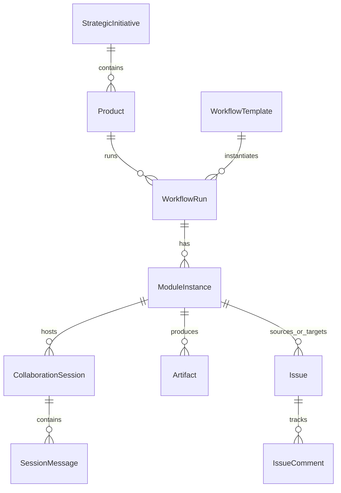

# ModuFlow 阶段 1 实施计划 (Implementation Plan)

## 一、目标与交付标准

阶段 1 的核心目标是**跑通自上而下「战略工程 → 产品矩阵 → 流程模板 → 13 模块协作空间 → 人机交互会话 → 跨模块 Issue 流转与基线锁定」的完整端到端闭环**。

### 验收切片（End-to-End Vertical Slice）
1. **创建/查看战略工程**（例如「进军东南亚市场」）。
2. **在战略下创建产品并选择流程模板**（例如「记账本东南亚版」选择「快速迭代模板」，或「QuickPay」选择「完整 13 模块模板」）。
3. **进入模块协作空间**（例如 PRD 模块）：
   - 人类发送指令，Agent（内置模拟/执行器）回复并输出初稿产物（`draft_artifact`）。
   - 人类提出修改意见，Agent 迭代生成修正版（`revised_artifact`）。
4. **结构化 Issue 跨模块流转**：
   - 在测试模块发现问题，创建结构化 Bug Issue，目标指向开发模块或 PRD 模块。
   - 目标模块收到待办，在会话中完成修复并更新状态。
   - 测试人员回验并关闭 Issue。
5. **门禁与基线锁定**：
   - 检查所有 Critical/Major Issue 已关闭，评审通过，锁定基线（`baselined`）。
   - 依赖此模块的下游模块自动解锁变为可协作状态。

---

## 二、系统架构与技术选型

```
ModuFlow/
├── backend/                  # Python 3.10+ / FastAPI / SQLAlchemy / SQLite
│   ├── app/
│   │   ├── api/              # RESTful API 端点
│   │   │   ├── initiatives.py
│   │   │   ├── products.py
│   │   │   ├── workflow_runs.py
│   │   │   ├── modules.py
│   │   │   ├── sessions.py
│   │   │   ├── issues.py
│   │   │   └── artifacts.py
│   │   ├── core/             # 核心配置、数据库与引擎
│   │   │   ├── config.py
│   │   │   ├── database.py
│   │   │   └── state_machine.py # 模块四阶段跃迁与门禁引擎
│   │   ├── models/           # SQLAlchemy 数据持久化实体
│   │   ├── schemas/          # Pydantic 数据校验与契约
│   │   └── services/         # 业务逻辑（Agent 响应模拟/执行、Issue 路由、依赖拓扑）
│   ├── tests/                # 自动化测试
│   ├── pyproject.toml / requirements.txt
│   └── main.py
│
├── frontend/                 # React 18+ / Vite / TypeScript / Tailwind CSS
│   ├── src/
│   │   ├── components/       # 公共组件（Navbar, StatusBadge, IssueModal）
│   │   ├── pages/            # 核心页面
│   │   │   ├── Dashboard.tsx      # 战略总览与产品列表
│   │   │   ├── WorkflowView.tsx   # 产品 13 模块看板与状态视图
│   │   │   ├── ModuleSpace.tsx    # 模块协作空间（会话 + 产物 + Issue）
│   │   │   └── IssueBoard.tsx     # 全局/跨模块 Issue 看板
│   │   ├── services/         # API 请求客户端
│   │   ├── types/            # TypeScript 接口定义
│   │   └── App.tsx
│   ├── package.json
│   ├── tailwind.config.js
│   └── vite.config.ts
│
├── data/                     # 本地 SQLite 数据库与快照存储目录
├── docs/                     # 架构文档与说明
└── run.sh                    # 一键启动脚本（前后端并发启动）
```

---

## 三、核心数据模型设计 (Database Schema)



1. **StrategicInitiative（战略工程）**: `id`, `name`, `description`, `owner`, `budget`, `status`, `created_at`
2. **Product（产品）**: `id`, `initiative_id`, `name`, `code`, `description`, `created_at`
3. **WorkflowTemplate（流程模板）**: `id`, `name`, `description`, `modules_config`, `default_dependencies`
4. **WorkflowRun（工作流运行实例）**: `id`, `product_id`, `template_id`, `name`, `status`, `created_at`
5. **ModuleInstance（模块协作空间实例）**:
   - `id`, `run_id`, `module_code` (01~13), `name`
   - `phase` (`draft` | `discussing` | `reviewing` | `baselined`)
   - `baseline_artifact_id`, `is_unlocked`, `dependencies`
6. **CollaborationSession & SessionMessage（协作会话与消息）**:
   - Message 类型: `instruction`, `feedback`, `draft_artifact`, `revised_artifact`, `question`, `issue`, `approve`, `reject`
7. **Issue（结构化问题）**:
   - `id`, `title`, `source_module_id`, `target_module_id`
   - `severity` (`critical`, `major`, `minor`, `trivial`)
   - `priority` (`P0`, `P1`, `P2`, `P3`)
   - `status` (`open`, `investigating`, `fixing`, `verifying`, `closed`)
   - `description` (JSON 包含 summary, steps, expected, actual, env)
8. **Artifact（产物不可变快照）**:
   - `id`, `module_id`, `version`, `title`, `content`, `content_hash`, `is_baseline`

---

## 四、实施步骤计划

- [ ] **步骤 1：后端基础搭建**
  - 初始化虚拟环境（使用 `uv`），配置 FastAPI、SQLAlchemy、SQLite。
  - 创建完整的数据模型（Models）、Pydantic 模式（Schemas）与数据库初始化迁移。
  - 预填 3 套标准流程模板（完整 13 模块、快速敏捷、紧急修复）和演示战略工程（进军东南亚市场）。
- [ ] **步骤 2：核心引擎与 API 实现**
  - 模块状态机控制逻辑（前置依赖校验、Issue 阻塞检查、基线锁定与下游解锁）。
  - 会话多轮对话 API（支持人机协作消息与 Agent 智能/模拟生成草稿产物）。
  - 结构化 Issue 全生命周期 API（跨模块指派、状态跃迁、回退触发）。
- [ ] **步骤 3：前端工程搭建与 UI 落地**
  - 初始化 Vite + React + TypeScript + Tailwind CSS。
  - 建设战略/产品总览页（Portfolio Dashboard）。
  - 建设产品工作流看板（13 模块状态链、门禁与解锁状态）。
  - 建设核心模块协作空间（左侧对话流、右侧产物实时预览与版本树、底部 Issue 快捷面板）。
  - 建设全局 Issue 看板（跨模块缺陷与反馈流转图）。
- [ ] **步骤 4：端到端连调与一键启动脚本**
  - 测试 PRD 讨论 → 草稿生成 → 提交 Bug → 跨模块派发到开发 → 修复回验 → 基线解锁。
  - 编写 `run.sh` 脚本，保障一键拉起前后端。
